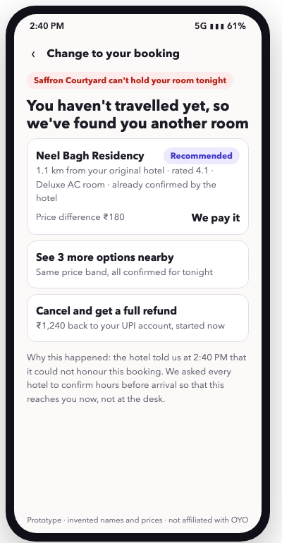
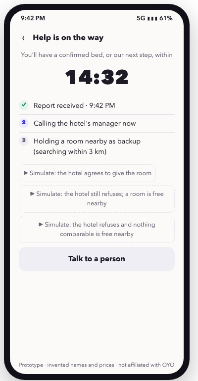
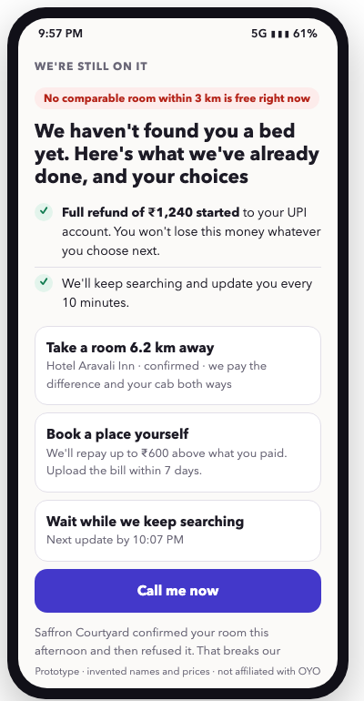
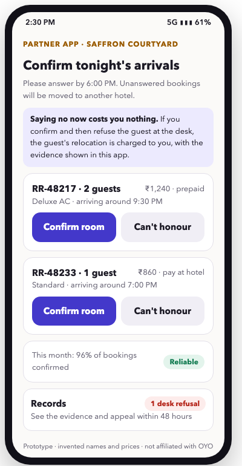

::: {align="center"}
# Booked, but no room.

### OYO Check-in Denial --- Product Case Study

**An independent product strategy, research and prototype project by
Vansh Gupta**

*Independent student case study. Not affiliated with, endorsed by, or
sponsored by OYO.*
:::

------------------------------------------------------------------------

## The problem

A guest arrives at an OYO property with a confirmed booking---sometimes
already prepaid---but the front desk refuses check-in. The guest is left
to negotiate, find another room, or seek a refund, often in an
unfamiliar city and at an inconvenient hour.

The central product question:

> How might OYO surface a hotel's refusal before the guest travels---and
> provide a reliable rescue when a denial still happens?

This case study focuses first on **same-day prepaid bookings**, where
the platform has already collected payment and made a clear promise to
the guest.

## The proposed solution: RoomReady

RoomReady is a two-sided confirmation and recovery flow designed around
one principle: **ask the property before the guest sets out, and rescue
the guest quickly if the desk still says no.**

-   **Pre-arrival confirmation:** The property confirms or declines the
    booking before a defined evening deadline.
-   **Early alternative:** If the property declines, the guest is
    offered a confirmed nearby room or a refund before travelling.
-   **Desk rescue:** If a denial happens at the property, a timed
    support flow works toward a confirmed alternative or refund, with a
    15-minute service target.
-   **Fair owner incentives:** An early decline is free within a defined
    limit; a refusal after confirmation carries the cost of relocation,
    subject to evidence and an appeal path.

The MVP combines four prioritised ideas. It deliberately avoids
unlimited free declines and uncapped compensation because the financial
model showed that generous policies could create substantial additional
cost.

## Evidence snapshot

The analysis examines guest-app reviews and hotel-owner app (Co-OYO)
reviews to understand both sides of the check-in failure.

  -----------------------------------------------------------------------
  Signal                                                          Finding
  ------------------------------ ----------------------------------------
  Denied check-in as a share of                                   **37%**
  arrival-stage problems in the  
  analysed recent guest-review   
  subset                         

  Denials with a stated reason                                    **73%**
  that appear to have been       
  decided before arrival         

  Denied guests who report                                        **10%**
  ultimately getting a bed       
  through OYO or the hotel       
  -----------------------------------------------------------------------

The review analysis also identifies recurring owner-side complaints
around payouts, support, deductions and room pricing. These matter
because a solution that improves the guest experience by ignoring owner
incentives is unlikely to work operationally.

**Important research limitation:** Review coding was performed by an AI
model against a written codebook. Human validation of a random sample of
100 coded reviews is **pending**. Treat review-derived counts as
AI-coded and not yet human-checked. Reviews are not a measure of denial
rate per booking, and the project does not claim that the proposed
product has been built or experimentally validated.

## Product experience

The screens below are selected from the clickable prototype. They cover
the guest journey and the property-owner confirmation flow.

### Guest: moved before travel

### Guest: desk rescue

### Guest: no nearby room available

### Property owner: confirm tonight's arrivals

**[Open the interactive prototype
→](https://vanshhgupta.github.io/oyo-case-study/prototype/)**

## Impact model: cost the solution before choosing it

The project includes a spreadsheet model with editable assumptions and
live formulas. The base-case estimate is approximately break-even:

  -----------------------------------------------------------------------
  Annual                Pessimistic               Base         Optimistic
  scenario                                             
  -------------- ------------------ ------------------ ------------------
  Estimated                 ₹0.8 cr            ₹4.0 cr           ₹11.4 cr
  benefit                                              

  Estimated cost            ₹6.2 cr            ₹3.9 cr            ₹3.0 cr

  **Estimated          **−₹5.4 cr**       **+₹0.1 cr**       **+₹8.4 cr**
  net impact**                                         
  -----------------------------------------------------------------------

These are **scenario projections, not measured results**. The model
makes assumptions explicit, including the booking-denial rate, which is
not publicly available. The sensitivity to additional owner declines is
a key reason the final design limits free early declines.

**[Download the impact model (Excel) →](strategy/impact_model.xlsx)**

## Success metrics

-   **North-star metric:** Share of prepaid bookings in which the guest
    checks into a confirmed room at the price paid, with no extra
    payment demanded at the desk.
-   **Leading indicator:** Share of bookings confirmed by the property
    before the deadline.
-   **Guardrails:** Additional owner declines, net cost per 1,000
    bookings, owner churn, upheld owner appeals and desk-report abuse.
-   **Experiment proposal:** Randomise by property rather than by guest,
    since the policy changes owner behaviour. The case study proposes an
    eight-week test.

## What's included in this repository

  -----------------------------------------------------------------------
  Area                                Contents
  ----------------------------------- -----------------------------------
  [`case-study/`](case-study/)        Main case-study page, one-page PDF
                                      and prototype screenshots

  [`prototype/`](prototype/)          Clickable guest and owner prototype

  [`research/`](research/)            Review analysis, codebook, feature
                                      audit, sources and validation
                                      materials

  [`strategy/`](strategy/)            Problem definition, solution
                                      prioritisation, metrics and impact
                                      model

  [`prd/`](prd/)                      Product requirements document
  -----------------------------------------------------------------------

### Key documents

-   [One-page PDF](case-study/one_pager.pdf)
-   [Full case
    study](https://vanshhgupta.github.io/oyo-case-study/case-study/)
-   [Product requirements document (PRD)](prd/PRD.html)
-   [Review analysis](research/review_analysis.html)
-   [Research codebook](research/codebook.html)
-   [Feature audit](research/feature_audit.html)
-   [Research sources](research/sources.html)
-   [Problem definition](strategy/problem.html)
-   [Solution prioritisation](strategy/solutions.html)
-   [Metrics and experiment plan](strategy/metrics.html)
-   [Impact model (Excel)](strategy/impact_model.xlsx)

## Approach

1.  **Frame the failure:** Map the guest's arrival experience and
    identify where the booking promise breaks.
2.  **Study both sides:** Analyse guest and property-owner app reviews;
    compare the current promise, policy and recovery experience.
3.  **Find the mechanism:** Treat denial as a consent and incentive
    problem---not only a customer-support problem at arrival.
4.  **Explore and prioritise:** Generate solution options, score them
    and document trade-offs.
5.  **Design the MVP:** Define the guest and owner flows, including
    failure and appeal states.
6.  **Cost the proposal:** Model benefits, operating costs and
    owner-behaviour risks before settling on the design.
7.  **Define measurement:** Specify a north-star metric, guardrails and
    a property-level experiment.

## What I would validate next

1.  Interview hotel owners and front-desk managers about how they decide
    whether to honour an OYO booking.
2.  Obtain the actual denial rate per prepaid booking and current
    relocation-versus-refund outcomes.
3.  Complete human validation of the 100-review sample and update the
    analysis if needed.
4.  Test the owner price-floor hypothesis and the proposed confirmation
    deadline with properties.

## Methodology and disclaimer

This is an independent portfolio case study based on publicly accessible
app reviews, public policy/market materials and a scenario-based impact
model. No interviews with OYO employees, hotel owners or guests were
conducted for this version. Review data is directional and subject to
selection bias; it should not be interpreted as representative incidence
data. The impact model is assumption-led and describes a proposal, not
actual OYO performance.

OYO is referenced solely to identify the company being studied. This
project is not affiliated with OYO, and no OYO logo or proprietary app
design is used. Property names in the prototype are fictional.

------------------------------------------------------------------------

::: {align="center"}
**[View the live case
study](https://vanshhgupta.github.io/oyo-case-study/) · [Explore the
prototype](https://vanshhgupta.github.io/oyo-case-study/prototype/) ·
[Open the PDF](case-study/one_pager.pdf)**
:::
